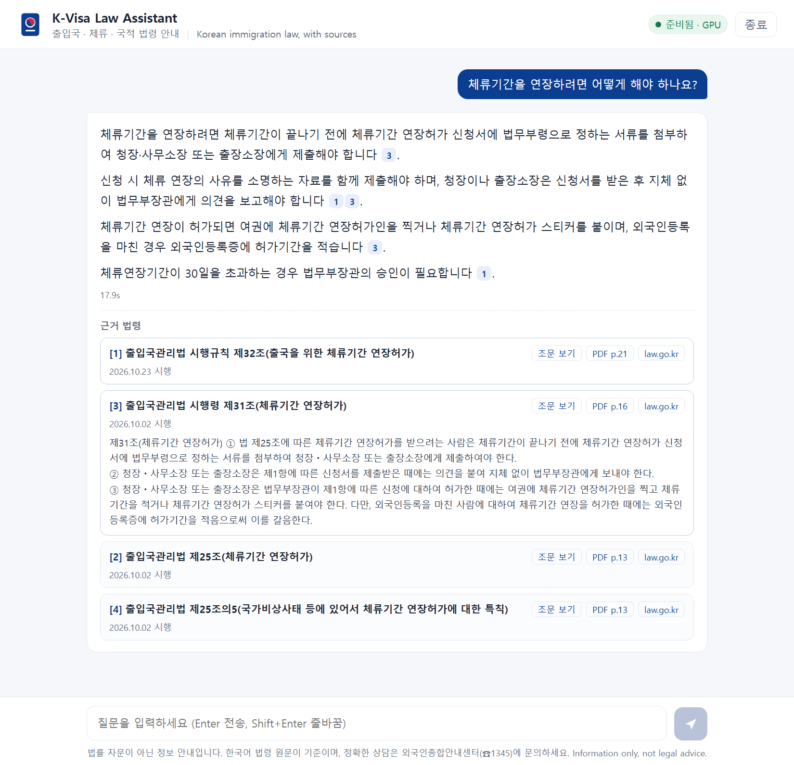

# K-Visa Law Assistant

Ask questions about Korean immigration, visa and nationality law in Korean or English, and get a
short answer that cites the exact law article it comes from. Retrieval-augmented generation (RAG)
over the official law PDFs, running fully on your own PC with open models on the GPU.



## Highlights

- **Official sources**: the current Korean text of 9 laws and 18 attached tables (visa types,
  maximum stay, required documents, fines), downloaded as PDFs from the National Law Information
  Center (law.go.kr).
- **Practical rules too**: the Ministry of Justice guide *Visa Navigator* (part-time work for students,
  visit booking, reporting deadlines, real counselling cases) is downloaded to your PC and searched
  next to the laws; the answer says when something comes from the guide.
- **Every answer cites its sources**, e.g. `출입국관리법 제31조(외국인등록)`, with a link that opens
  the official PDF on the right page. When the documents do not answer a question, it says so.
- **Measured honestly** on 129 test questions, including 30 harder held-out questions written after
  the search method was chosen (results below).
- **Runs on a laptop GPU**: everything (embedding the 923 pieces, reranking, answering all test
  questions) runs locally on an NVIDIA RTX 3060 Laptop GPU, using about 5.5 of its 6 GB of GPU memory.
- **Private and offline**: no API key, nothing leaves the PC after setup.
- Web chat UI (FastAPI) and a double-click **`KVisaLaw.exe`**.

## How it works

```text
law.go.kr PDFs ───► parse ─► 870 law pieces ─┐
(laws, tables)       (one per article,        ├─► bge-m3 vectors (local Qdrant)
                      one per visa-table row) │
Visa Navigator PDF ─► parse ─► 53 guide pieces┘
                                                      │
question ──────────────► meaning search ─► 20 best law pieces + 5 best guide pieces
                                                      │
                               bge-reranker-v2-m3 ─► 4 law pieces + 1 guide piece
                                                      │
                                                      ▼
                         Qwen3-4B-Instruct (4-bit, GPU): short answer with [1] [2] citations
```

| Step | File | What it does |
|---|---|---|
| Download | `kvisa/download.py` | Finds the version of each law in force today on law.go.kr and saves the law PDF and its attached-table PDFs |
| Parse | `kvisa/parse.py` | Reads the PDFs with PyMuPDF: one piece per article (long articles split at ①, ②), one per table row; rebuilds the spaces that the table PDFs leave out; drops amendment notes and addenda |
| Guide | `kvisa/download_guides.py` | Downloads the *Visa Navigator* guide to `data/guides/` (not in the repository, see licenses); `parse.py` splits it by page and item |
| Search | `kvisa/search.py` | bge-m3 embeddings in a local Qdrant collection, then a cross-encoder reranker; laws and guide are ranked in separate pools. A BM25 keyword search over Korean character pairs is kept as a baseline |
| Answer | `kvisa/answer.py` | Qwen3-4B-Instruct-2507 in 4-bit reads the 5 pieces, answers in the question's language and cites them; laws take priority over the guide |
| Evaluate | `kvisa/evaluate.py` | Search and answer metrics on the test questions in `eval/` |
| App | `kvisa/server.py`, `app/` | FastAPI backend with streaming answers and a chat page with source cards |

## Results

Three question sets in `eval/`, each question labelled with the source(s) that answer it:

- **Main**: 80 questions in plain language (72 Korean, 8 English) covering all 9 laws, plus 4
  questions the laws cannot answer (office address, online booking, exact part-time hours, card
  waiting time).
- **Held-out**: 30 harder questions with more indirect wording ("Can I work at a convenience store
  as a student?"), written after the search method below was chosen. It was later used once, with
  the other two sets, to choose how many guide pieces the model reads.
- **Guide**: 15 practical questions answered by the *Visa Navigator* guide (part-time work rules,
  visit booking, reporting deadlines, fines in real cases).

### Search: is the right article found?

Measured on the laws before the guide was added. "In context" means the right article is among the
4 law pieces the answer model reads.

| Method | Main: 1st | Main: in context | Held-out: 1st | Held-out: in context | Time |
|---|---|---|---|---|---|
| Keyword (BM25) | 45% | 74% | 17% | 33% | 0.00 s |
| Meaning (bge-m3) | 85% | 95% | 40% | 73% | 0.03 s |
| Hybrid (keyword + meaning) | 57% | 95% | 33% | 60% | 0.02 s |
| **Meaning + reranker (used)** | 80% | 95% | **60%** | **80%** | 0.65 s |
| Hybrid + reranker | 80% | 96% | 47% | 70% | 0.65 s |

What the numbers showed:

- **Keyword search fails on everyday wording**, and mixing it in (hybrid) made results worse, not
  better. The laws use formal terms (체류자격 외 활동) that questions rarely contain.
- On the main set the reranker looked useless (80% vs 85% first), but **on the held-out questions it
  was clearly better** (60% vs 40% first, 80% vs 73% in context), so the app uses it. The main set
  turned out to be too close to the article titles; without the held-out set the results would have
  looked better than they are.
- A small glossary of everyday words (아르바이트 → 체류자격 외 활동허가) fixed the misses of the main
  set but did nothing on the held-out set, so it was dropped.
- Splitting the visa tables into one piece per visa type made questions like "What visa does the
  foreign spouse of a Korean get?" findable.
- **Adding the guide to the same ranked list pushed law articles out** (in context 95% → 91% on
  main, 80% → 70% on held-out). Ranking laws and guide in separate pools and giving the model the
  4 best law pieces + the best guide piece keeps the law results at **95% / 80%** and puts the right
  guide page in context for **93%** of the guide questions.

### Answers: laws only vs laws + guide

| | Main (80) | Held-out (30) | Guide (15) |
|---|---|---|---|
| Answer cites an expected source, laws only | 94% | 77% | 13% |
| Answer cites an expected source, **laws + guide** | 90% | 70% | **93%** |
| Wrongly said "not found", laws only → laws + guide | 2.5% → **0%** | 6.7% → **0%** | 13% → **0%** |
| Answered in the language of the question | 100% | 100% | 100% |
| Median time per answer (RTX 3060 Laptop) | 13.4 s | 13.3 s | 14.5 s |

The citation rate on the law sets dropped a little, so every answer that changed was read by hand:

- **6 became better**: questions the laws-only version refused are now answered correctly from the
  guide: student part-time work (Korean and English), the visa of a Korean citizen's foreign spouse
  (F-6), the maximum stay of F-4, HiKorea visit booking, and "how many hours per week can a D-2
  student work" (it now says the weekly limit is not in the documents but explains the rule).
- **3 stayed correct but cite the guide instead of the law article** (re-entry permit exemption,
  C-3 visa, F-5 requirements), which the automatic score counts as a miss.
- **2 became worse**: "my visa expires next week" mixed up the regular extension with the
  extension for departure, and "bringing my parents" mixed F-1 and F-2 rules.

Without the guide, the model was not only unhelpful on practical questions but sometimes
**confidently wrong**: it said a D-2 student cannot work part-time, that the F-6 visa restricts
work, and that permanent residents must extend their stay. With the guide these are answered
correctly. This is why the answer prompt also says: do not conclude that something is allowed (or
forbidden) just because the sources do not mention it.

Out-of-scope questions: with the laws only, all 4 were answered with "not found". With the guide,
2 of the 4 are partly answerable (visit booking is explained in the guide; the D-2 weekly hours are
not, and the answer says so), so the automatic count drops to 2 / 4.

### Adding the 2026 HiKorea manuals

With the two HiKorea manuals saved as PDF (1,335 pages, see Setup), the model reads the 4 best law
pieces plus the best page from the manuals or the guide:

| | Main (80) | Held-out (30) | Guide (15) |
|---|---|---|---|
| Answer cites an expected source, laws + Visa Navigator | 90% | 70% | 93% |
| Answer cites an expected source, + 2026 manuals (first try) | 95% | 77% | 73% |
| Answer cites an expected source, **+ 2026 manuals (fixed)** | **94%** | **73%** | **93%** |
| Median time per answer (fixed) | 16 s | 17 s | 13 s |

- The manuals help the law questions (more visa-specific detail) and answer things nothing else
  covers: required documents per visa, the D-2 part-time hour limits by TOPIK level.
- The first try lost guide questions for three reasons, now fixed:
  - Search reranked only the 20 nearest guide pages. With 1,400 manual pages added, the right
    Visa Navigator page was 22nd or 29th, so it never reached the reranker. Now 40 are reranked.
  - Manual pages were cut to 1,000 characters, which dropped the D-2 hours table at the bottom of
    the page (the answer said a flat "30 hours"). The model now reads whole pages.
  - One correct answer cited its source as "[자료] 1번" instead of "[1]" and was scored as uncited.
- The small drops on the law sets are scoring, not worse answers: by hand, the C-3 and E-9
  workplace-change answers are correct but cite the manual page instead of the law article. The
  convenience-store question now says the laws have no clear rule but a permit is needed
  (before: "no problem"), which the scoring counts as a refusal. Still weak: "do permanent
  residents need an extension?" mixes up the extension with renewing the residence card.
- Printing HWP to PDF splits numbers from their words ("발급일로부터 개월 … 3"); lines are rebuilt
  from character positions to put them back.
- Only the best page above a minimum relevance is used: an unrelated page (score near 0) misled the
  model more than no page. Two pages per answer did not fit a 6 GB GPU (answers took minutes), so
  questions are embedded on the CPU, which leaves room for one whole page.
- Tested and dropped: letting the model rewrite the question into official terms before searching.
  On the held-out set it found the right article less often (19 vs 24 of 30).

In the app the first words appear after 1 to 2 seconds (streaming). A first version refused to
answer when the reranker score of the best piece was below 0.05; it blocked 8 real questions and
only 2 out-of-scope ones, while the model refused every out-of-scope question by itself, so the
threshold was removed. All answers are saved in `docs/answer_metrics.json` (laws + guide) and
`docs/answer_metrics_laws_only.json`.

## Setup (Windows)

1. Install Python 3.11+ (64-bit). An NVIDIA GPU with 6 GB or more is recommended
   (tested on an RTX 3060 Laptop GPU); without one, answers are slow.
2. Double-click `INSTALL_WINDOWS.bat`. It installs the packages, downloads the open models
   (about 12 GB), the *Visa Navigator* guide, optionally the English translations, and builds the
   search index.
3. Double-click **`KVisaLaw.exe`**. The chat opens in your browser; it runs only on your PC.
   Use **종료** (Stop) in the top bar to close it.

**Adding the HiKorea manuals (optional).** The most detailed guides, *사증민원 / 체류민원 자격별 안내
매뉴얼* on [HiKorea](https://www.hikorea.go.kr/board/BoardNtcDetailR.pt?BBS_SEQ=1&BBS_GB_CD=BS10&NTCCTT_SEQ=1062&page=1),
are published as copy-protected HWP files (배포용 문서), which this project does not try to unlock.
Open them in the free Hancom viewer, print them with **Microsoft Print to PDF**, and save them as
`data/guides/visa_manual_2026.pdf` and `data/guides/stay_manual_2026.pdf`; then run
`python -m kvisa.parse` and `python -m kvisa.search build`. They are KOGL Type 4 like the Visa
Navigator and stay on your PC.

Windows SmartScreen may warn once because the exe is not code-signed: **More info → Run anyway**.

Command line:

```bat
.venv\Scripts\python.exe -m kvisa.download              & rem official Korean law PDFs (already in data/)
.venv\Scripts\python.exe -m kvisa.download_english      & rem optional English translations, personal use
.venv\Scripts\python.exe -m kvisa.download_guides       & rem Visa Navigator guide, kept on this PC
.venv\Scripts\python.exe -m kvisa.parse                 & rem PDFs -> data\articles.jsonl (+ guides)
.venv\Scripts\python.exe -m kvisa.search build          & rem search index
.venv\Scripts\python.exe -m kvisa.answer "외국인등록은 언제까지 해야 하나요?"
.venv\Scripts\python.exe -m kvisa.evaluate search       & rem compare search methods
.venv\Scripts\python.exe -m kvisa.evaluate answers      & rem answer all test questions
.venv\Scripts\python.exe -m unittest discover -s tests -t .
.venv\Scripts\python.exe -m kvisa.server --port 8000
```

## Project structure

```text
K-Visa-Law-Assistant/
├── KVisaLaw.exe                # Double-click launcher
├── kvisa/
│   ├── download.py             # Official Korean law PDFs from law.go.kr
│   ├── download_english.py     # Optional KLRI English translations (git-ignored)
│   ├── download_guides.py      # Ministry of Justice guide (git-ignored)
│   ├── parse.py                # PDFs -> articles, table rows and guide pieces
│   ├── search.py               # Meaning search + reranker (and keyword baseline)
│   ├── answer.py               # Answers with citations from a local model
│   ├── evaluate.py             # Search and answer metrics
│   ├── server.py               # FastAPI backend
│   ├── models.py               # Downloads the open models
│   └── config.py
├── app/                        # Chat page (HTML, CSS, JavaScript)
├── data/laws/ko/               # Official law PDFs + manifest
├── data/articles.jsonl         # 870 searchable pieces
├── eval/                       # Test questions (main, held-out, guide)
├── docs/                       # Metrics and screenshots
├── tests/
└── launcher/                   # Exe source, icon and build script
```

## Limitations

- **Information, not legal advice.** The Korean law text is the official version. For your own case,
  ask the Immigration Contact Center (☎ 1345) or an expert.
- **Only what the documents say.** Office hours, addresses or exact weekly part-time hours are in
  neither the laws nor the guide; the app answers "not found" for them.
- **The guide is from December 2022.** Rules change more often than laws; guide sources are labelled
  with their date in the app, and answers must say when they rely on the guide. The 2026 HiKorea
  manuals would be more current but are copy-protected (see Setup).
- **Everyday wording is the hardest part.** A question like "Can a student work at a convenience
  store?" must be matched to "activities outside the status of stay" (Article 20). With the laws only
  the model answered "no problem"; with the guide it now says that prior permission for part-time
  work is required, but it still sometimes adds examples that are not in the sources. Search misses
  some indirect questions (see the held-out results).
- **A small model still makes mistakes**, for example mixing up two similar rules (see the answers
  that became worse above). Always check the cited article before acting.
- Some spaces between Korean words are missing where a line wraps in the PDF; search is not affected.
- The laws change: run `python -m kvisa.download` and rebuild to update. The data in this repository
  is the version in force on 2 Nov 2026.

## Credits and licenses

- Code: MIT (see `LICENSE`).
- Laws: official Korean texts from the [National Law Information Center](https://www.law.go.kr/)
  (Ministry of Government Legislation). Korean statutes are not protected by copyright
  (Copyright Act, Article 7).
- English translations: [Korea Legislation Research Institute](https://elaw.klri.re.kr/), copyrighted;
  downloaded only to your own PC for personal use and never included in this repository.
- Guide: *비자 내비게이터 (Visa Navigator)*, Ministry of Justice, Korea Immigration Service, Dec 2022,
  [immigration.go.kr](https://immigration.go.kr/bbs/immigration/47/566047/artclView.do), published
  under [KOGL Type 4](https://www.kogl.or.kr/) (attribution, non-commercial, no
  changes). It is downloaded to your own PC and never included or modified in this repository.
- Models: [BAAI/bge-m3](https://huggingface.co/BAAI/bge-m3) (MIT),
  [BAAI/bge-reranker-v2-m3](https://huggingface.co/BAAI/bge-reranker-v2-m3) (Apache-2.0),
  [Qwen/Qwen3-4B-Instruct-2507](https://huggingface.co/Qwen/Qwen3-4B-Instruct-2507) (Apache-2.0).
- Vector database: [Qdrant](https://qdrant.tech/) (local mode).
